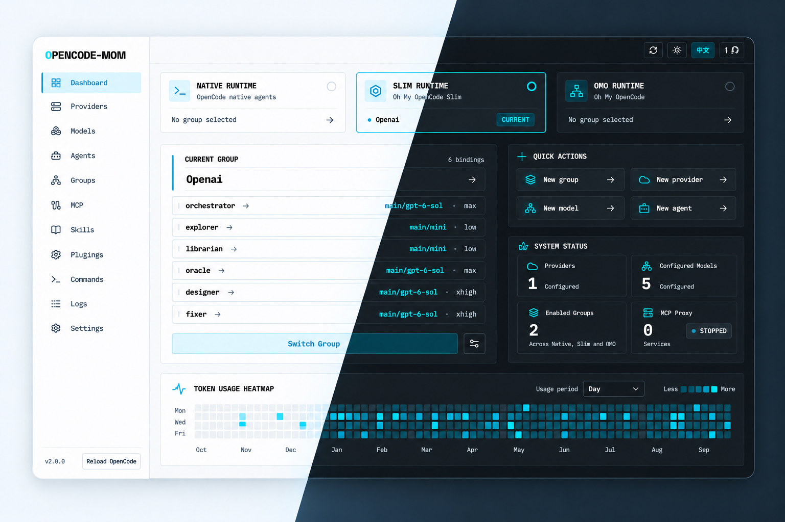

<div align="center">


# opencode-mom

**Model-group manager for OpenCode v2.**<br />
One window. Three runtimes — **Native**, **Slim**, and **OMO**. One click to switch model groups without touching hand-tuned configuration.

[](https://github.com/seho-dev/opencode-mom/releases/latest)


[](https://github.com/seho-dev/opencode-mom/stargazers)

[English](README.md) · [简体中文](README.zh-CN.md)

</div>

> [!IMPORTANT]
> **opencode-mom requires OpenCode v2.** It manages v2 configuration schemas, `provider/model#variant` selectors, and v2 permission rules. V1 configs are neither migrated nor managed.

<div align="center">



</div>

## 🌟 Overview

**opencode-mom** ("MOM") is a cross-platform desktop application designed to keep multi-runtime OpenCode v2 configurations clean, organized, and instantly switchable. It manages named **model groups**, binding providers, models, agents, and categories across three runtimes:

- **Native** — OpenCode builtin agents, written to `~/.config/opencode/opencode.jsonc` (or `opencode.json`).
- **Slim** — Oh My OpenCode Slim, written to `~/.config/opencode/oh-my-opencode-slim.json`.
- **OMO** — Oh My OpenAgent, written to `~/.omo/omo.jsonc`.

Projection is **non-destructive**: keys outside the active group definition are preserved untouched.

## ✨ Features

- **🧩 One-Click Model Group Switching**: Switch between preset configurations instantly from the **Dashboard**, **Groups** view, or the **System Tray**. Duplicate an existing group into a prefilled draft to modify and save as a new group.
- **🧠 Providers, Models & Agents**: Register custom API endpoints (OpenAI-compatible, Anthropic, or custom), configure models and pricing, and manage agent permissions and system prompts (inline JSON or Markdown).
- **🔌 MCP & Skills Management**: Manage MCP servers with masked credentials and automatic recovery snapshots. Includes a built-in **MCP HTTP Proxy** bridging local stdio MCP servers over HTTP/SSE for external clients.
- **🏝️ MOM Mini Island (macOS)**: Notch-integrated status capsule that also sits flush against the top screen edge on Macs without a notch, showing cached project/session context plus session and pending-request counts, glanceable session health, live status waveforms, main-session completion perimeter lighting, persistent approval attention, and fast interactions (approve permissions, answer prompts, or interrupt sessions).
- **💤 Lid Protection (macOS / Windows)**: Prevents your laptop from sleeping **only while OpenCode sessions are actively working**, automatically restoring your normal power policy when tasks finish.
- **🔔 Native OS Notifications (macOS / Windows)**: Stay informed with native desktop notifications.
- **📊 Dashboard & System Tray**: Real-time service health, active session counts, token consumption analytics, activity heatmaps, and a lightweight tray menu for background operation.

### 🪵 Local Diagnostic Logs

- **Dedicated Controls & Viewer**: Independent logging switch in **Settings → General** (off by default); disabling recording preserves existing history. An independent `/logs` viewer in the navigation menu (not embedded in Settings) supports manual refresh, opening the log directory, and confirmed clearing.
- **Correlated Tracing & State Recording**: Records results of critical mutations; ordinary polling successes are omitted, while power and Mini Island record only published state transitions. Each entry requires `type`, `status` (`success` | `error`), and links checkpoints via `operationId` (a successful step checkpoint does not imply the entire operation succeeded).
- **Viewer & Filtering**: Supports filtering by type, status, and time range. Loads older pages via cursor pagination (50 records per page), and operation traces retain up to 100 events. Pagination cursors expire on file rotation or clear; manual refresh resets the query. Records and operation traces can be copied to the clipboard as pretty-printed JSON, exporting only currently loaded retained events chronologically without fetching additional history; this remains a diagnostic aid rather than a complete audit log.
- **Storage & Permissions**: Stored locally in `~/.config/opencode-mom/logs` (Windows: `%USERPROFILE%\.config\opencode-mom\logs`), rotating up to 5 JSONL files capped at 5 MiB each. Unix sets directory `0700` and file `0600` permissions; Windows uses inherited permissions (without verified private ACLs).
- **Safe Allowlist & Diagnostic Scope**: Strictly allowlisted fields; never records credentials, passwords, tokens and their verification data, prompts, session messages, configuration contents, request/response bodies, or raw errors, with no automatic upload. Intended for local diagnostics rather than compliance auditing; process termination, disk errors, or queue overflow may cause record loss.

## 📦 Install

Download pre-built binaries from **[GitHub Releases](https://github.com/seho-dev/opencode-mom/releases/latest)**:

| Platform | Artifact | Note |
| :--- | :--- | :--- |
| **macOS (Apple Silicon)** | `opencode-mom_*_aarch64.dmg` | M1/M2/M3/M4 chips |
| **macOS (Intel)** | `opencode-mom_*_x64.dmg` | Intel Macs |
| **Windows (x64)** | `opencode-mom_*_x64-setup.exe` | NSIS installer |

### macOS First Launch
Builds are ad-hoc signed. If macOS blocks opening the application:
1. Open **System Settings → Privacy & Security**.
2. Click **Open Anyway** next to the `opencode-mom` notification.
3. *Alternative (terminal)*:
   ```bash
   xattr -dr com.apple.quarantine "/Applications/opencode-mom.app"
   ```

### Requirements
- **[OpenCode v2](https://opencode.ai/v2/docs/)** installed for live service status, session monitoring, Mini Island, and native notifications. (Editing configuration files works standalone).

## 🔧 How MOM Writes Config

MOM persists its own state in `~/.config/opencode-mom/config.json` and patches target configuration files without overwriting unmanaged fields:

The logging switch is stored as `state.loggingEnabled` (default `false`), independent of theme, locale, model groups, and project selection. Log records are saved separately in JSONL files under `logs/` and never written to `config.json`.
Notification settings are stored as `state.notifications` (default disabled), independent of theme, locale, model groups, and logging. When enabled on macOS or Windows, native notifications alert on root agent completions, approval requests, and agent errors.

| Group Type | Target File | Patched Keys |
| :--- | :--- | :--- |
| `native` | `~/.config/opencode/opencode.jsonc` (fallback `opencode.json`) | `agents.<name>.model` |
| `slim` | `~/.config/opencode/oh-my-opencode-slim.json` | Agent model bindings |
| `omo` | `~/.omo/omo.jsonc` | Categories & agent overrides |

## 🛠️ Development

Requirements: Node.js 22.x, npm, Rust ≥ 1.77.2, and Tauri 2 system prerequisites.

```bash
npm ci                 # Install dependencies
npm run tauri dev      # Launch app in development mode
npm run tauri build    # Package desktop app for current platform
```

Quality checks:

```bash
npm run check          # Biome format & lint check
npm run test:unit      # Frontend unit tests
cargo check --manifest-path src-tauri/Cargo.toml   # Rust backend check
cargo test --manifest-path src-tauri/Cargo.toml    # Rust backend tests
```

### Release

The project uses the GitHub Actions **Release** workflow on the default branch:

- **Automated**: Commit to the default branch with `release` or `release: description` (bumps the next patch version, e.g. `2.0.1`, or next beta e.g. `2.0.1-beta.2` if currently on beta), or `release: X.Y.Z` / `release: X.Y.Z-beta.N` for an explicit version.
- **Manual**: Dispatch the `Release` workflow on the default branch with optional `version` (`X.Y.Z` or `X.Y.Z-beta.N`; leave empty for the next patch or next beta).
- **Beta Releases & Stable Promotion**: Initiating a beta uses `X.Y.Z-beta.N`. While on a beta, automatic bumps increment the beta counter (`-beta.N+1`). Transitioning from beta to stable must be explicit by supplying `X.Y.Z`. Beta releases are published as GitHub pre-releases and not marked as latest.
- **Update Checks**: In-app update checks only track the latest stable release. Beta builds are notified only when the matching or newer stable release is published; they are never prompted for subsequent beta releases.
- **Dry Run**: Pass `dry_run: true` on manual dispatch (defaults to `false`) to preview the resolved version and notes without committing, tagging, pushing, building, or publishing.
- **Notes & Safety Notice**: GitHub Release notes use the exact tagged section from `CHANGELOG.md` (falling back to commit history if absent) with platform security notices appended. Pushing a version-matching `vX.Y.Z` or `vX.Y.Z-beta.N` tag directly verifies manifests and publishes without changelog writeback.
- **Pipeline & Permissions**: The workflow uses the built-in `GITHUB_TOKEN` with `contents: write`; branch and tag rules must permit the release bot's generated commit and tag. Token write permission alone does not bypass branch protection. Release preparation prepends `CHANGELOG.md`, synchronizes 6 manifests (`package.json`, `package-lock.json`, `src-tauri/tauri.conf.json`, `src-tauri/Cargo.toml`, `src-tauri/Cargo.lock`, `src-tauri/Info.plist`) while leaving `macos-helper` untouched, and pushes the branch and tag atomically. Publication waits for all platform builds. If build or publish fails, rerun the original failed workflow without another version bump.

## 📄 License

Released under the [MIT License](LICENSE). © 2026 seho-dev.
