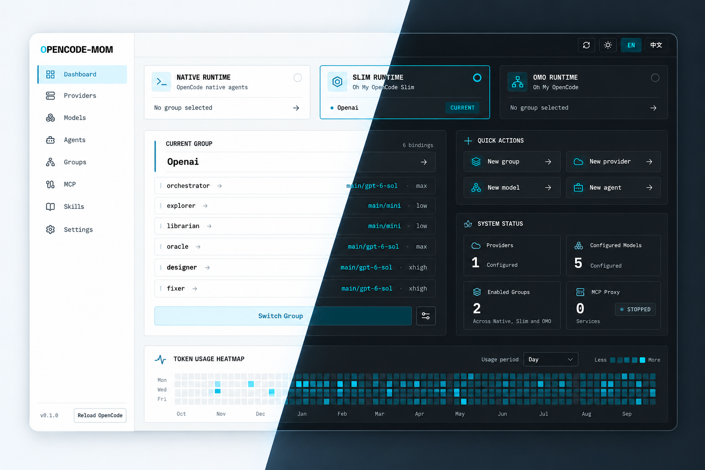

<div align="center">


# opencode-mom

**OpenCode v2 的模型组管理器**<br />
一个窗口，三套运行时 —— **Native**、**Slim**、**OMO**。一键切换整套 agent 配置，手改的配置键一个不动。

[](https://github.com/seho-dev/opencode-mom/releases/latest)


[](https://github.com/seho-dev/opencode-mom/stargazers)

[English](README.md) · 简体中文

</div>

> [!IMPORTANT]
> **opencode-mom 仅支持 OpenCode v2。** MOM 读写的是 v2 配置体系 —— `provider/model#variant` 模型选择器、v2 权限规则、v2 provider/model schema。V1 配置不会被迁移，也不会被管理。切换模型组前，请确认你的 OpenCode 已升级到 v2。

> [!NOTE]
> **⭐ 个人目标：100 stars。**
> macOS 构建目前采用 ad-hoc 签名，没有 Apple Developer ID 证书，也未公证。达到 100 stars 后，我计划自费加入 Apple Developer Program，并推进签名与公证发布。
> 如果 MOM 帮到了你，欢迎点个 Star，但这完全自愿，不影响下载或使用任何功能；Star 是鼓励，不是证书费用。感谢支持；如果你更希望自行签名，也可以从源码构建自己的副本。

> [!WARNING]
> **macOS 首次启动需要主动确认是否信任。**
> 把 `opencode-mom.app` 拖进 `/Applications` 后，先尝试打开一次。若被拦截，优先使用 **系统设置 → 隐私与安全性 → 仍要打开**；这个 GUI 步骤通常已经足够。
>
> 下方命令**不是必做步骤**。仅当可信的官方副本仍被拦截，或系统没有 **仍要打开** 选项时，才考虑这个可选备用方法，**仅对这个 App**移除 quarantine 标记，无需 `sudo`：
>
> ```bash
> xattr -dr com.apple.quarantine "/Applications/opencode-mom.app"
> ```
>
> 🔒 仅对从本仓库官方 [Releases](https://github.com/seho-dev/opencode-mom/releases/latest) 下载、并已查看源码和发布信息的副本考虑这些步骤。不要为不可信构建绕过 quarantine，也不要全局关闭 Gatekeeper。

<div align="center">



*MOM 一览 —— Native、Slim、OMO 三套运行时，实时 OpenCode 服务状态、token 用量与活动热力图，含明暗主题。*

</div>

## 🌟 opencode-mom 是什么？

**opencode-mom**（简称 **MOM**）是一个跨平台桌面应用，让多运行时（multi-runtime）的 OpenCode v2 配置保持整洁、随时可切。它管理命名的**模型组（model groups）**，每组为一种运行时绑定 provider、model、agent 与 category：

- **Native** —— OpenCode 原生 agents，写入 `~/.config/opencode/opencode.jsonc`（或 `opencode.json`）。
- **Slim** —— Oh My OpenCode Slim，写入 `~/.config/opencode/oh-my-opencode-slim.json`。
- **OMO** —— Oh My OpenAgent，写入 `~/.omo/omo.jsonc`。

模型组投影采用一对一的 key patch，不属于该组的键原样保留。

## ✨ 功能特性

### 🧩 模型组 —— 一键切换整套配置

- 每种运行时对应命名组，包含 category 映射与逐 agent 的模型绑定，支持 `#variant` 选择。
- 可从**仪表盘**、**Groups 页**或**托盘弹窗**切换，选中即生效。
- 实时展示 OpenCode 服务健康状态与工作中的 session 数；切换后按需提醒重载 OpenCode 服务配置。
- 非破坏式：手工调整过的键会保留；更改组的类型时，只移除该组曾拥有过的键。

### 🧠 Providers、Models 与 Agents

- **Providers** —— 注册自定义 OpenAI 兼容、Anthropic 或任意 endpoint，支持 API key、base URL 与自定义 headers，并做校验。
- **Models** —— 模型目录支持 modality（text、audio、image、video、pdf）、上下文上限、input/output/cache 定价与自定义 variant；选定本地服务的 enabled 模型与配置模型合并，disabled 配置模型仍可编辑。
- **Agents** —— 浏览内置目录（native / slim / omo 共 24 个 agent）或自定义：mode、`provider/model#variant` 选择器、system prompt、颜色，以及可视化 v2 权限规则（`allow` / `ask` / `deny`）。定义可内联在配置中，也可存为全局 Markdown；编辑保留原始来源快照，拒绝过期内容或已改指向的来源。

### 🔌 MCP 与 📚 Skills

- **MCP** —— 跨配置源查看全部已注册 server、检查诊断信息、隐藏敏感凭据、编辑原始 JSON、安全删除；文件替换失败时保留恢复用 `.bak` 快照。内置 MCP HTTP Proxy 网关，支持将本地 stdio MCP 服务器转为 HTTP/SSE 服务供 OpenCode/Claude 等客户端接入，具备 Bearer 令牌鉴权与跨平台进程树安全回收。
- **Skills** —— 发现本地与远程 skill，查看并编辑内容、查看诊断信息。远程 skill 只读。

#### Global 与已保存的项目根目录

- 只有 **MCP、Agents 与 Skills 列表页**提供范围选择器。通过系统原生文件夹选择器添加项目根目录，在已保存的根目录间切换，或直接返回 **Global**。这三个页面共用上次的范围选择；再次添加同一文件夹不会创建第二条记录。
- 首个版本的**项目范围只读**：可浏览列表与详情。**显示 Global 配置**仅添加只读对照，不代表 OpenCode 实际生效的运行时配置。Global 的新增、编辑、删除独立于已保存的项目选择，仍可使用。Providers、Models、Groups、Settings、托盘，以及 OpenCode 正在运行的组 / 服务均不受影响。
- 移除根目录只会忘记已保存的记录，不会删除其文件。若当前选中的记录被移除，选择器会返回 Global。文件夹不存在时，记录仍保留并报告 `not_found`，不会自动回退到 Global。

选定根目录为 `R` 时，预期的项目路径如下：

| 资源 | 项目路径 |
| :--- | :--- |
| MCP / JSON agents | `R/opencode.json`、`R/opencode.jsonc`、`R/.opencode/opencode.json`、`R/.opencode/opencode.jsonc` |
| Markdown agents | `R/.opencode/agent`、`R/.opencode/agents` |
| Skills | `R/.opencode/skill`、`R/.opencode/skills` |

仅检查所选根目录：不发现祖先、同级或子孙项目，不读取项目内的 `.claude` / `.agents` 路径。两种范围均不发现 `mode` / `modes` 目录。这只是有限的配置源浏览器，并非 OpenCode 的完整发现机制或实际生效状态。

添加与读取项目时，拒绝 filesystem/volume root，以及项目固定来源与 MOM 已捕获的 Global 配置文件或资源根目录（含 overrides）的 canonical 路径重叠。不按用户主目录或最小目录深度一概禁止；路径检查不保证抵御并发 symlink 改动。

Global 识别原生 `agent` / `agents` 与 `skill` / `skills` 目录别名，并保留现有的 `~/.claude/skills` 与 `~/.agents/skills` 根目录。配置中的相对 skill 路径（如 `./team-skills`）在**两种范围中均被忽略**。Global 保留配置中的绝对路径、以 `~/` 开头的用户目录路径与 HTTP(S) Remote Catalogs；项目范围忽略**所有**配置中的额外 skill 来源，包括绝对路径、用户目录路径与 URL，只使用上表的固定原生目录。

### 📊 仪表盘、用量与托盘

- 实时状态：当前组与运行时、OpenCode 服务健康状态、运行中的 session。
- Token 用量（input / output / cache）与活动热力图，支持日 / 周 / 月 / 年视图。
- 托盘弹窗：切换模型组、重载 OpenCode 服务配置、打开应用或设置、退出。关闭主窗口只会隐藏到托盘。

### 🏝️ MOM Mini Island —— 首个版本（仅 macOS）

- **Settings 开关，默认关闭：** 修改后立即持久化并应用。共有三种形态：小岛无品牌文字，仅保留一个状态标记；hover 或键盘 focus 自动显示中岛快捷区且不抢焦点；点击中岛的向下展开按钮才打开大岛 mini 会话窗口。所有屏幕默认小岛，原生刘海几何仅决定信息密度：有刘海只显示单一状态标记，无刘海在小岛内额外显示简短状态和数量。点击小岛只进入中岛，不直接进入大岛。新待处理请求不会自动放大窗口，各状态都会改变真实原生窗口尺寸。展开后浏览近期 root session 和全局 active session，包含 active child，但不是完整历史。所选 session 展示最新有界消息页中最多 20 条公开 user/assistant 消息，每条最多 16 KiB，超出截断；不展示 reasoning、tool output 或 hidden/internal 内容。
- **显式交互：** 发送纯文本、单次允许或拒绝权限请求、回答受支持的 string/multiselect 问题字段（允许时可自定义输入），或主动 interrupt session。**Allow once** 保持默认操作；仅当 OpenCode 提供非空 `save` 规则时，下拉菜单才提供 **Always for this project**。hover 只打开选项，不会授权。Always 将该请求的 action 和 `save` 模式保存在其 OpenCode Project 中，也可能放行其他匹配的待审批请求；这与 MOM 当前选择的配置范围无关。不支持的 form 保持只读。使用选定的本机 **OpenCode V2 服务**：默认 Shared Service，或显式固定的本地 OpenChamber endpoint。Shared 模式可能通过 CLI 启动服务；固定模式绝不启动服务。不支持 V1、远程 server 或 Plugin 集成。⚠️ HTTP API 属于实验性接口；透明 macOS 窗口启用了 `macOSPrivateApi`，面向 `.app`/DMG 分发，不面向 Mac App Store。
- **本地生命周期与隐私：** 关闭开关会 abort monitor、清空私有 cached state 并销毁窗口，不会拒绝请求或停止 OpenCode。关闭后不保留 Island SSE stream 或 polling；已经运行的有界 connection worker 可能继续最多 20 秒，在完成前更换 target 返回 `busy`。丢弃本地 write 无法撤回 server 已接受的 POST。凭据留在 Rust；Island 代码不记录原始 response 或消息文本。刘海、显示器、Spaces/fullscreen 与唤醒行为仍需执行下方独立手动验收。

### 💤 合盖守护 —— 盖上盖子继续干活（macOS / Windows）

- 仅当选定的本地服务里**确有 OpenCode session 在工作**时保持唤醒，结束后自动恢复原始电源策略。
- macOS 通过内置 helper 切换 `SleepDisabled`，需一次性管理员授权；Windows 会记录并恢复当前电源方案的 AC/DC 合盖动作。
- 附手动合盖验收清单（见[开发](#-开发)）—— 自动化测试不能替代真实合盖测试。

### 🌗 原生体验

- 英文 / 简体中文界面，深色（默认）与浅色主题，开机自启，单窗口控制台加托盘快捷入口。

## 🏝️ 路线图

- **macOS Developer ID 签名与公证** —— 计划在个人目标 ⭐ 100 stars 达成后自费加入开发者计划；Star 不能购买证书。

## 📦 安装

从 **[GitHub Releases](https://github.com/seho-dev/opencode-mom/releases/latest)** 获取最新构建：

| 平台 | 产物 |
| :--- | :--- |
| Windows (x64) | `opencode-mom_*_x64-setup.exe` —— NSIS 安装包 |
| macOS (Apple Silicon) | `opencode-mom_*_aarch64.dmg` |
| macOS (Intel) | `opencode-mom_*_x64.dmg` |

Workflow 也提供两种 macOS 架构的 `.app.tar.gz`。Windows 安装包未签名，可能显示 **SmartScreen** 警告；请核对发布者与来源，仅对自己准备安装的官方 Release 决定是否继续。

### macOS 首次启动

构建采用 ad-hoc 签名，但没有 Developer ID 签名或公证 —— 优先使用系统设置中的 **仍要打开**，通常已足够；上方限定范围的 quarantine 命令仅作为可选备用方法。

### 手动更新与 Settings 检查

**Settings（设置）** 显示实际运行的 App 版本。点击 **检查更新**，按数字比较稳定 `X.Y.Z` 版本与 GitHub 最新稳定 Release。结果区分发现新版本、已是最新、尚无已发布版本以及错误；版本无法读取或格式无效、网络失败、限流都不代表已经是最新版。发现更新时，**查看 GitHub 下载** 会在浏览器打开官方 Releases 页面。请手动下载与安装：不会自动检查，也不会自动安装。

- **macOS：** 先从托盘菜单选择 **Quit（退出）**（关闭窗口只会隐藏）。下载适合自己 Mac 的 Apple Silicon（`aarch64`）或 Intel（`x64`）`.dmg`，打开后把 `opencode-mom.app` 拖入 `/Applications` 并选择 **替换**，然后重新打开 App。若被拦截，按上方 **仍要打开** 指引处理；quarantine 命令不是更新的必做步骤。
- **Windows：** 从托盘退出 MOM，再运行新版未签名 NSIS 安装包 `opencode-mom_*_x64-setup.exe`，完成后重新打开 App。只有信任自己准备安装的官方 Release 下载时，才考虑继续通过 **SmartScreen** 提示。

重新打开后，确认 **Settings** 显示的实际版本与安装的 Release 一致，并自行检查开机自启与合盖守护状态。合盖守护会改变系统电源策略，请执行下方手动验收清单，不要假定升级已自动验证这些行为。

### 环境要求

- **OpenCode v2** 用于状态、session、模型发现、reload、Token 用量和 Mini Island。Shared Service bootstrap 与 CLI 安装管理按 `$OPENCODE_BIN` → 标准安装路径 → `$PATH` 顺序查找二进制。
- 仅编辑配置无需 CLI 或服务；服务不可用时明确报错，绝不伪装为 idle session 数量。

### OpenCode V2 安装与升级

平台要求与最新安装说明参见 [V2 官方文档](https://opencode.ai/v2/docs/)。官方 CLI 安装方式包括：

```sh
curl -fsSL https://opencode.ai/v2/install | bash
npm install -g @opencode/cli@2
bun install -g @opencode/cli@2
pnpm add -g --allow-build=@opencode/cli @opencode/cli@2
yarn global add @opencode/cli@2
vp install -g @opencode/cli@2
brew install anomalyco/tap/opencode-v2
```

V2 官方文档还提供 AUR、手动下载 binary、Desktop App 和 Docker 的说明；请按对应平台指引操作。

🔒 审查下载的 installer，仅使用官方来源。**Settings → OpenCode** 只在本地检查选定 CLI；检查更新、升级均需主动点击。MOM 仅对严格证明来源的 Unix curl/npm/bun/pnpm/yarn 安装提供自动升级，且当前版本必须为稳定 V2 **≥ 2.0.25**；调用选定 binary 的原生 `selected_binary upgrade <stable-V2-target> --method <method>`。执行前校验预期 path/version 和所有权，执行后从相同 path 读回并验证版本。Windows、Homebrew、Vite Plus、旧版 V2、OpenChamber bundled binary、未经证明及手动安装均保持手动升级。MOM 不使用 `sudo`，不升级 bundled binary，也不停止或重启服务。CLI 版本不等于运行中的 backend 版本：更新 binary 后旧服务可能仍在运行。请检查状态，在安全时使用其所属应用的官方生命周期操作。

### 本地 OpenCode service target

- **Shared Service（默认）：** 验证 `$XDG_STATE_HOME` 或 `~/.local/state` 下的 `opencode/service.json`，使用 Basic 用户 `opencode`，核对 `/api/info` 的 PID/version 与 registration 一致。API 操作仅在 registration 缺失、不可达或身份不匹配时允许一次有界 CLI bootstrap；非法 registration、Unauthorized 等明确 HTTP 错误均 fail closed。Settings 状态探测从不 bootstrap。
- **固定本地 endpoint（可选）：** 填写本机 OpenChamber 所属的直接 OpenCode V2 backend endpoint，不是 Web UI port 或 UI proxy。仅接受 `http://127.0.0.1:PORT`、`http://[::1]:PORT` 或精确 `http://localhost:PORT`（不经 DNS，规范化为 `127.0.0.1`）。配置 backend service password 时使用 Basic 用户 `opencode`；无 password 时不发送 Authorization header。MOM 不推断 Bearer 或 UI pairing authentication，401/403 绝不触发 auth fallback。`/api/info` 成功仅确认 PID/version 可达，不代表已获得 protected route 访问权限。固定 endpoint 失败绝不回退 Shared Service、其他 CLI 发现的 backend 或 MOM 自建服务，也绝不 bootstrap。允许离线保存；连接失败不会撤销已成功保存的配置。
- active session、模型目录、reload、用量、合盖监控和 Mini Island 全部共用此 target。`/api/session/active` 仅描述该 backend process（含 active child），不是全机器清单。模型目录的 `location[directory]` 选择服务 context，不是另一个 server；MOM 只读项目配置范围与运行中的 OpenCode service/location 相互独立。
- 保存 target 后会自动重连已启用的 **Mini Island** 并刷新 **合盖守护**，保留两个开关及当前电源授权；已关闭的功能仍保持关闭。旧 Island 消息、草稿和 session 数量会失效；合盖守护先恢复旧电源设置，再查询新 target，恢复失败时明确显示错误，不伪装为 protected 或 idle。保存不 interrupt 外部 session，也不重启服务。进行中的 bootstrap、reload、Island write 或首次电源授权会让更换 target 返回 `busy`，等待操作结束后重试即可。进行中的读取拒绝旧 target 结果，Island 消息读取与操作还必须匹配调用界面展示的 connection generation。write 在 dispatch 前复核 PID/version，且不自动重试；该复核无法原子阻止 health 与 dispatch 之间的外部 restart。
- 🔒 endpoint/password 仅由 backend 持久化到 `~/.config/opencode-mom/opencode-service.json`，不进入 aggregate app config。Unix 以明文保存到 account-owned `0600` regular file，文件上限为 8 KiB。Windows 将 `encryptedPassword` 保存为 numeric bytes，使用原生当前账户 DPAPI 保护，文件上限为 32 KiB、ciphertext 上限为 8 KiB；没有明文 fallback，解密失败时 fail closed。Shared Service registration credentials 单独处理。请使用专用 backend password：Unix 权限与 DPAPI 均无法抵御账户失陷、同账户恶意 process 或管理员。password 不返回 frontend，也不进入 DTO/event/error/log。本 macOS host 未执行 Windows-native DPAPI 测试，不宣称已验证 Windows ACL 保护。
- 省略 password 仅在规范化 URL 未改变时保留；空字符串显式清除；更换 URL 或返回 Shared 会丢弃它。保存采用 atomic publication；发布后的 directory-sync warning 不会撤销已提交的 selection。

Windows 可用以下诊断，仅显示 process/service 状态，不输出 password 或 command line：

```powershell
Get-CimInstance Win32_Process | Where-Object Name -Match '^(opencode|openchamber)(\.exe)?$' | Select-Object ProcessId, Name, ExecutablePath
Get-CimInstance Win32_Service | Where-Object Name -Match 'opencode|openchamber' | Select-Object Name, State, ProcessId
```

与 Settings 显示的 backend PID/version 及所属应用核对；process 存在不代表 API 健康或认证成功。不要把 registration、environment dump 或可能含凭据的 process command line 粘贴到诊断中。

## 🔧 MOM 如何写入配置

MOM 把模型组、选择状态、已保存的项目根目录及共用的上次范围选择保存在自己的 `~/.config/opencode-mom/config.json`，与被管理的目标文件分离：

Island 开关保存为 `state.islandEnabled`（默认 `false`），独立于 theme/locale preferences；保存 preferences 或修改模型组会保留该字段。

| 组类型 | 目标文件 | 写入的键 |
| :--- | :--- | :--- |
| `native` | `~/.config/opencode/opencode.jsonc`（回退 `opencode.json`） | 仅 `agents.<name>.model` |
| `slim` | `~/.config/opencode/oh-my-opencode-slim.json` | agent 模型绑定 |
| `omo` | `~/.omo/omo.jsonc` | categories 与 agent overrides |

- **非破坏式投影。** 组定义之外的键会作为残留配置保留。切换到别的组或删除组时，目标文件保持不动；更改组的类型时，只移除该组曾拥有过的键。
- **App 配置发布。** MOM 自有配置的 read/modify/write 仍共用同一进程内 mutex；保存时在目标同目录 staging 完整文件、sync，再以 atomic rename 发布，不创建 `.bak`。通用目标配置写入仍为不加锁、不备份的普通写入。
- **资源恢复。** 已有文件中的 inline agent CRUD、Markdown agent 更新、MCP 替换和本地 skill 更新采用快照校验后替换；失败保留恢复用 `.bak`，成功后清理。Global 静态 symlink 仍受支持；过期内容与检测到的改指向会被拒绝。预期路径仅标识已发现的来源，不是任意写入目标；这些检查不消除 filesystem race。
- **环境变量覆盖。** `OPENCODE_CONFIG_DIR` 覆盖 OpenCode 配置目录；`OPENCODE_CONFIG` 指定一个显式的受管文件 —— 它同时是 Global MCP 与 Skills 发现的最高优先级来源。项目浏览仅使用上方所选根目录的路径。
- **资源边界。** 项目资源只读。新建的 Global Markdown agent 与 skill 使用复数 `agents` / `skills` 目录；不会迁移旧目录，更新时沿用原路径，或在来源重复时报告歧义。保存或选择根目录不会迁移或重命名文件、重载 OpenCode 服务配置、执行 Plugin 或启动 MCP server。
- **空则跳过。** 组内没有生效的 OpenCode override 时会跳过 OpenCode 同步，因此缺少 OpenCode 配置文件只会挡住真正需要它的操作。

## 🛠️ 开发

环境：Node.js 22.23.0 + npm、Rust ≥ 1.77.2（CI / 发布固定 1.96.0），以及 Tauri 2 对应平台的构建依赖。

```bash
npm ci                # 安装依赖
npm run tauri dev     # 开发模式运行
npm run tauri build   # 打包当前平台
```

检查：

```bash
npm run check                 # Biome 格式化 + lint
npm run test:components      # Vitest 组件测试（jsdom）
npm run test:unit            # node --test 单元测试
node --test scripts/release-version.test.mjs
cargo fmt --manifest-path src-tauri/Cargo.toml --all -- --check
cargo check --manifest-path src-tauri/Cargo.toml
cargo test --manifest-path src-tauri/Cargo.toml
```

不要手改生成目录（`build/`、`.svelte-kit/`、`src-tauri/target/`、`src-tauri/gen/`）。

<details>
<summary><b>Mini Island 手动验收（macOS；尚未执行）</b></summary>

🔒 发送消息、允许/拒绝请求、回答 form 与 interrupt 都会主动改变 OpenCode session。仅使用可丢弃的测试项目，以及你明确批准用于测试的请求。这不是电源策略测试，不要修改合盖守护设置。以下 native 检查只有在对应 Mac/显示器环境实际执行后才能确认；自动化测试不能替代。

1. 使用全新的 MOM App 数据启动，确认 **Settings → Mini Island** 默认关闭，且没有胶囊/Island monitor。源码构建可使用上方开发命令（`npm run tauri dev`）。
2. 在浅色桌面背景下启用，确认小岛出现且不抢焦点，黑底连续、中间不漏背景，没有 MOM 文字或多余的右侧 icon。本机服务有任务运行时，确认唯一的状态标记显示清晰波形（启用 reduced motion 时保持静态波形）。hover 或点击小岛任一可见区域进入中岛快捷区，不读取消息或执行授权；鼠标停留时保持中岛，移出后确认真实原生窗口矩形缩小。物理摄像头刘海不属于可见操作区域。授权菜单打开或审批进行中时，移出不得打断操作。hover 中岛的向下按钮不得进入大岛，点击后才展开。在大岛的 textarea 输入，再测试 Escape（优先关闭授权下拉菜单）与点击其他 App：收起后小岛仍可见，不能留下大块透明鼠标拦截区。
3. 测试有刘海/无刘海屏幕、不同 DPI 的外接显示器、Spaces、全屏 App 及 sleep/wake。两种屏幕启动和收起后都应显示小岛，仅无刘海屏幕额外显示简短状态和数量，不加载会话消息。确认定位与交互，记录限制，不要假定具备 NSPanel 行为。这些硬件/桌面场景明确尚未验证。
4. 在可丢弃项目中创建安全的测试 session、权限请求和 form。检查 running/pending 与 active child 覆盖、纯文本消息、单次允许/拒绝、受支持的 string/multiselect/custom 回答、不支持 form 的只读状态和显式 interrupt。确认新请求只更新默认态标记；仅在核对显示的 action/模式及可能受影响的待审批请求后，测试非空 `save` 规则的 Always，无 `save` 时不得提供此选项。在 MOM 外解决另一请求，确认其消失。
5. 断开/重新连接 Shared Service 并使用 Refresh，检查恢复且没有自动写重试。快速关闭/启用开关，再保持 Island enabled 退出并重启，确认恢复且无旧 state 覆写或抢焦点。
   保持合盖守护关闭、Island 开启，保存另一个已确认的本地 backend：旧消息和草稿必须清空，再展示新 target 数据，即使 session ID 相同。离线 fixed target 必须保持选中并显示不可用。Island 关闭时重复切换，确认不会被开启。两个监控联动的电源检查仅按下方独立合盖验收流程执行。
6. 关闭开关，确认窗口消失但 OpenCode session 继续工作，且不会自动拒绝请求；允许有界 connection worker 最多 20 秒的收尾时间。最后从托盘选择 **Quit**，确认 Island monitor 清理；关闭主窗口不算退出。

</details>

### macOS 合盖 helper

`src-tauri/build.rs` 会以独立锁定 workspace 构建 `src-tauri/native/macos-helper`，ad-hoc 签名后内嵌。全新的 Cargo 缓存需先 fetch：

```bash
cargo fetch --manifest-path src-tauri/native/macos-helper/Cargo.toml --locked
cargo fmt --manifest-path src-tauri/native/macos-helper/Cargo.toml --all -- --check
cargo check --manifest-path src-tauri/native/macos-helper/Cargo.toml --offline --locked
cargo test --manifest-path src-tauri/native/macos-helper/Cargo.toml --offline --locked
```

不要直接运行 helper，也不要加 `sudo`；其测试使用 mock 电源后端。

<details>
<summary><b>手动合盖守护验收（macOS / Windows）</b></summary>

🔒 这项可选检查会改变真实系统电源设置。只在你掌控的笔记本上操作：保存工作、保持通风、全程有人看管。绝不要把已唤醒且合盖的笔记本放进包里。除非应用确认 **Protected**，否则保持开盖；**Checking**、**Unknown**、**Error** 都算不上确认。仅监控选定本地 OpenCode 服务里的工作 session。

1. 用只读命令记录基线：macOS `pmset -g`（`SleepDisabled`）；Windows `powercfg /getactivescheme` 与 `powercfg /qh SCHEME_CURRENT SUB_BUTTONS`（含隐藏的 AC/DC 合盖值）。
2. 仅 macOS：启用设置并取消管理员弹窗，确认进入错误 / 未保护状态且基线未变；在真正授权前重启应用。Windows 没有等价的应用授权弹窗。
3. 启用守护，在选定服务里启动一个真实工作 session，等待 **Protected** 且工作 session 计数为正；短暂合盖再打开，确认任务仍在继续。
4. 等待所有被监控的工作结束、状态变为 **Idle**，对比电源策略读回值与基线，确认再次短合盖仍遵循原始行为。
   保持开盖并启用两个监控，保存另一个已确认的本地 backend。确认两个开关保持开启、没有新的授权弹窗、旧数量和 grace 清空，且新 target 可显示 Protected 前先恢复基线电源策略。离线 target 必须显示不可用 / Unknown，不能沿用旧数量或显示 Idle。关闭守护后重复切换，确认仍保持关闭。
5. 在守护状态下用 **Quit MOM** 退出，退出后再次对比基线。关闭主窗口只是隐藏到托盘，不算退出测试。

若恢复情况无法确认：保持开盖、停止测试，重启应用进行恢复。自动化测试和策略读回成功，都不能替代在每台受支持笔记本 / 系统上的真实合盖验收。

</details>

## 🚢 发布

**Release** workflow 支持推送到 `main`（当前默认分支）、推送 `v*` tag，以及 **Actions → Release → Run workflow**。对于 `main` 上由 commit 触发的发布，只检查 **HEAD commit subject**，区分大小写：

- `release` 或 `release: description` → 下一个 patch 版本。
- `release: 2.1.0` → 指定稳定版本 `2.1.0`（规则为 `release: X.Y.Z`），必须严格高于当前 App 版本和已有稳定发布 tag。格式错误的数字版本、预发布版本、相同或更旧的版本均拒绝发布。为兼容 Windows VERSIONINFO，每个版本字段须为 `0..65535`，patch 递增溢出时拒绝发布。
- 不以小写 `release` 单词开头的 subject（包括 `releases`、`chore: release`）不发布，也不扫描此次 push 中更早的 commit。
- 手动 dispatch 必须选择默认分支；可选 `version` 接受稳定 `X.Y.Z`，留空则递增 patch。如重命名默认分支，请同时更新 workflow 的 push 分支过滤器。

准备阶段同步 `package.json`、`package-lock.json` 的两个根版本字段、`src-tauri/Cargo.toml` 和 `src-tauri/Cargo.lock` 的 App package，以及 `src-tauri/tauri.conf.json`，生成 `chore(release): vX.Y.Z` commit 并原子推送 commit 和 tag。准备阶段也会在 `CHANGELOG.md` 顶部插入新版本章节，内容为上一个稳定 tag 之后的 commit subject（排除发布 commit），并将其包含在发布 commit 中。独立 macOS helper 保留自身 package 版本。仓库 **Actions permissions** 与分支/tag 规则需允许 workflow 的 `GITHUB_TOKEN` 创建这个发布 commit 和 tag；不会绕过保护规则。

准备阶段串行执行，并检查默认分支 HEAD 是否变化；并发变更会使推送失败，不会覆盖新 commit。重跑只复用原触发 commit 的确切发布子 commit/tag；构建失败时重跑原 workflow 即可，无需再次递增版本。也可自行推送已有的 `vX.Y.Z` tag：它必须与**全部** App 版本来源一致，此路径只构建、不递增版本。不要移动已发布 tag。

先将当前 `v2.0` 分支的工作合并到默认分支 `main`，再触发发布或推送发布 tag。App manifest 使用 `2.0.0`，对应 tag 为 `v2.0.0`。当前版本为 `2.0.0` 时，`release` / `release: description` 会选择 `2.0.1`，而 `release: 2.0.0` 会被拒绝。要**原样发布当前 `2.0.0`**，合并时不要使用 release 前缀的 subject，并走上方已有 tag 路径：`v2.0.0` 必须指向全部 App 版本来源均已同步为 `2.0.0` 的合并后 commit，而不是使用递增版本的触发方式。

之后在**同一次 workflow run** 中，使用 Node **22.23.0**、Rust **1.96.0**，分别在 `macos-15`（Apple Silicon）、`macos-15-intel`（Intel）和 `windows-2022`（x64 NSIS）上构建。macOS 会先 fetch 独立 helper 的锁定依赖，再执行其 offline build。macOS 使用 ad-hoc 签名身份 `-`，没有 Developer ID 签名或公证；Windows 未签名。无需签名或 updater secrets。

Build jobs 只有仓库读取权限并上传 artifacts；仅在**三个平台全部成功**后，独立的写权限 job 才上传全部五个产物并发布 GitHub Release（新 Release 在上传完成前保持 draft）。重跑发布会替换同名产物，不会另建 Release。`GITHUB_TOKEN` 生成的 push 不会触发另一个 workflow，因此依赖 build jobs 必须保留。可用 `node --test scripts/release-version.test.mjs` 本地验证版本逻辑；真实 hosted build 仍需在 GitHub 实际运行后确认。

## 📄 许可证

基于 [MIT License](LICENSE) 发布。© 2026 seho-dev。
