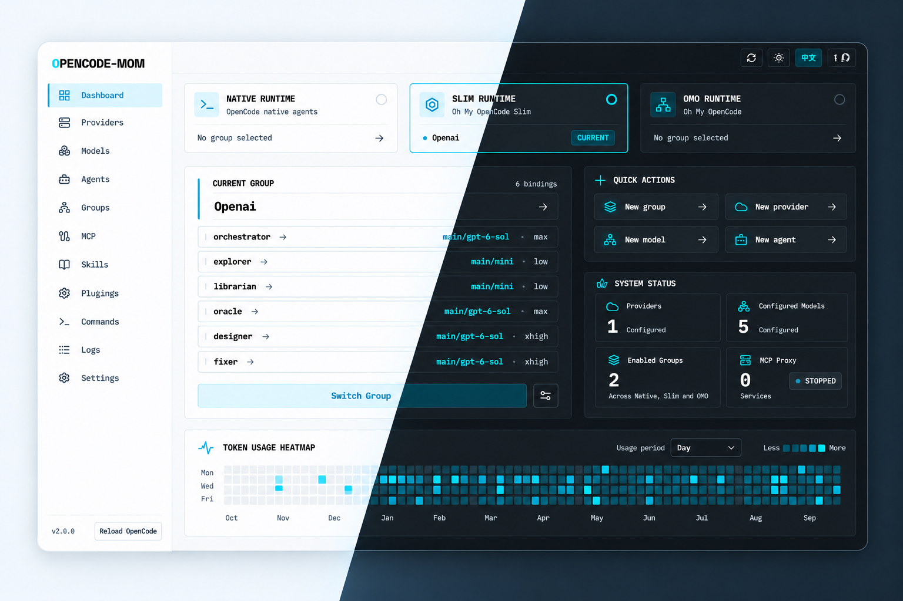

<div align="center">


# opencode-mom

**OpenCode v2 的模型组管理器**<br />
一个窗口，三套运行时 —— **Native**、**Slim** 与 **OMO**。一键切换整套模型配置，手改的配置字段原样保留。

[](https://github.com/seho-dev/opencode-mom/releases/latest)


[](https://github.com/seho-dev/opencode-mom/stargazers)

[English](README.md) · [简体中文](README.zh-CN.md)

</div>

> [!IMPORTANT]
> **opencode-mom 仅支持 OpenCode v2。** MOM 面向 v2 的配置规范、`provider/model#variant` 模型选择器与权限体系设计。V1 配置不会被迁移或管理。

<div align="center">



</div>

## 🌟 概览

**opencode-mom**（简称 **MOM**）是一款跨平台桌面应用，专为管理多运行时（multi-runtime）的 OpenCode v2 环境而生。它统一管理**模型组（Model Groups）**，为三种不同运行时快速绑定 Provider、Model、Agent 及 Category：

- **Native** —— OpenCode 原生 Agent，写入 `~/.config/opencode/opencode.jsonc`（或 `opencode.json`）。
- **Slim** —— Oh My OpenCode Slim，写入 `~/.config/opencode/oh-my-opencode-slim.json`。
- **OMO** —— Oh My OpenAgent，写入 `~/.omo/omo.jsonc`。

采用**非破坏式写入**：未包含在当前组定义内的手改字段全部保留。

## ✨ 核心特性

- **🧩 模型组一键切换**：在**仪表盘**、**Groups 页面**或**系统托盘**一键即时切换整套模型组合配置，支持复制现有模型组，在预填表单中修改并显式保存为新组。
- **🧠 Provider、Model 与 Agent 管理**：轻松注册自定义 API Endpoint（兼容 OpenAI、Anthropic 等协议），管理模型限额与定价，配置 Agent 权限与系统提示词（支持内联 JSON 及 Markdown 格式）。
- **🔌 MCP 与 Skill 管理**：集中管理 MCP 服务，自动打码敏感凭证；内置 **MCP HTTP Proxy**，可将本地 stdio MCP 服务转为 HTTP/SSE 供外部客户端接入。支持浏览与管理本地及远程 Skill。
- **🏝️ MOM Mini Island（macOS）**：专为 Mac 刘海屏设计的悬浮状态胶囊，在无刘海机型上同样贴合屏幕顶边，直观展示缓存的项目与会话上下文、会话与待处理请求计数、实时会话状态、波形动效、主任务完成环绕流光与待审批常驻提醒，并支持直接单次授权、表单回复及中断任务。
- **💤 合盖守护（macOS / Windows）**：**仅在 OpenCode 会话处于实际工作中时**阻止笔记本休眠，任务完成后自动恢复原系统电源策略。
- **🔔 系统原生通知（macOS / Windows）**：在**设置 → 通用**中开启**系统通知**（默认关闭），再独立选择主 Agent 完成、审批请求与 Agent 错误三类提醒。macOS 首次开启时请求系统授权；Windows 检查已安装应用的通知状态，并在需要时打开系统设置。修改系统权限后，在 MOM 中点击**刷新通知设置**。保存的通知偏好与系统授权相互独立。MOM 运行期间（包括驻留托盘时）生效，不依赖 Mini Island；专注或勿扰模式仍可能阻止展示。请使用打包后的 macOS 应用或已安装的 Windows 应用。
- **📊 实时仪表盘与系统托盘**：实时查看服务健康状态、工作会话数、Token 消耗统计、活动热力图，通过托盘菜单常驻后台便捷操作。

### 🪵 本地诊断日志

- **独立控制与专属查看器**：在**设置 → 通用**中提供独立开关（默认关闭），关闭记录仍保留已有历史；导航菜单提供独立的 `/logs` 查看器（未嵌入设置页），支持手动刷新、打开存储目录与确认后清空历史。
- **关联追踪与状态记录**：记录关键变更操作的结果，普通轮询成功不记入日志，电源与 Mini Island 仅记录已发布的状态流转；每条记录包含必需的 `type`、`status`（`success` | `error`）并由 `operationId` 关联检查点（单步检查点成功不代表整体操作成功）。
- **查看与筛选机制**：查看器支持按类型、结果状态及时间范围筛选，基于游标按页加载更早记录（每页 50 条），单项操作可追溯最多 100 条保留事件；日志轮转或清空后分页游标失效，手动刷新将重置查询。支持将单条记录与操作过程以格式化 JSON 复制到剪贴板，仅按时间顺序导出当前已加载的保留事件而不额外拉取历史，定位为诊断排查辅助而非完整合规审计日志。
- **存储规格与访问权限**：本地存储于 `~/.config/opencode-mom/logs`（Windows 为 `%USERPROFILE%\.config\opencode-mom\logs`），最多轮转保留 5 个 5 MiB 的 JSONL 文件；Unix 设置目录 `0700`/文件 `0600` 权限，Windows 采用继承权限（未进行私有 ACL 校验）。
- **安全白名单与诊断性质**：采用严格字段白名单，绝不记录凭据、密码、Token 及其校验数据、提示词、会话消息、配置内容、请求与响应体或原始错误，无任何自动上传；本功能仅供本地诊断调试而非合规审计，进程被强制终止、磁盘故障或队列溢出可能导致记录丢失。

## 📦 安装与下载

从 **[GitHub Releases](https://github.com/seho-dev/opencode-mom/releases/latest)** 获取对应平台的预编译安装包：

| 平台 | 安装产物 | 说明 |
| :--- | :--- | :--- |
| **macOS (Apple Silicon)** | `opencode-mom_*_aarch64.dmg` | M 系列芯片 |
| **macOS (Intel)** | `opencode-mom_*_x64.dmg` | Intel 处理器 Mac |
| **Windows (x64)** | `opencode-mom_*_x64-setup.exe` | NSIS 安装包 |

### macOS 首次启动提示
应用采用 ad-hoc 签名。如果首次打开提示未信任或被拦截：
1. 打开 **系统设置 → 隐私与安全性**。
2. 在安全性提示旁点击 **仍要打开** 即可正常启动。
3. *备选方式（终端执行）*：
   ```bash
   xattr -dr com.apple.quarantine "/Applications/opencode-mom.app"
   ```

### 环境要求
- 需已安装 **[OpenCode v2](https://opencode.ai/v2/docs/)**（用于获取实时服务状态、会话监控、Mini Island 及系统原生通知功能；普通配置编辑可独立使用）。

## 🔧 配置写入机制

MOM 将自身状态保存在 `~/.config/opencode-mom/config.json` 中，仅对目标配置文件进行精准增量修改，绝不破坏未受管字段：

日志功能开关存储为 `state.loggingEnabled`（默认 `false`），独立于主题、语言、模型组与项目选择，日志记录单独保存在 logs/ 下的 JSONL 文件中，不写入 config.json。通知设置存储为 `state.notifications`（默认关闭），独立于主题、语言、模型组与日志；在 macOS 或 Windows 开启后，系统原生通知将提示根 Agent 完成、审批请求及 Agent 错误。

| 模型组类型 | 目标配置文件 | 增量修改的字段 |
| :--- | :--- | :--- |
| `native` | `~/.config/opencode/opencode.jsonc`（回退 `opencode.json`） | `agents.<name>.model` |
| `slim` | `~/.config/opencode/oh-my-opencode-slim.json` | Agent 模型绑定关系 |
| `omo` | `~/.omo/omo.jsonc` | Category 分类与 Agent 覆盖项 |

## 🛠️ 本地开发

运行环境：Node.js 22.x、npm、Rust ≥ 1.77.2，以及 Tauri 2 平台依赖。

```bash
npm ci                 # 安装依赖
npm run tauri dev      # 本地启动桌面应用
npm run tauri build    # 打包当前平台安装产物
```

质量检查：

```bash
npm run check          # Biome 格式化与 Lint 检查
npm run test:unit      # 前端单元测试
cargo check --manifest-path src-tauri/Cargo.toml   # Rust 后端编译检查
cargo test --manifest-path src-tauri/Cargo.toml    # Rust 后端测试
```

### 发布流程

项目通过 GitHub Actions 的 **Release** 工作流在默认分支触发发布：

- **自动触发**：向默认分支提交标题为 `release` 或 `release: 描述` 的 commit（自动提升下一补丁版本，例如 `2.0.1`），或使用 `release: X.Y.Z` 显式发布更新的稳定版本。
- **手动触发**：在 GitHub Actions 中手动 dispatch 执行 `Release` 工作流，支持可选的 `version`（`X.Y.Z`，留空默认提升下一补丁版本）。
- **预演模式（Dry Run）**：手动触发时可设置 `dry_run: true`（默认为 `false`），仅预览计算后的版本号与发布说明，不会生成 commit、tag、推送、构建或发布。
- **发布说明与安全提示**：GitHub Release 说明精准引用 `CHANGELOG.md` 中对应 tag 的章节内容（若缺失则回退到 commit 历史记录），并附带平台安全提示说明。直接推送版本匹配的 `vX.Y.Z` tag 会校验清单一致性并直接发布，不执行 changelog 回写。
- **权限与重试保护**：工作流使用具备 `contents: write` 权限的内置 `GITHUB_TOKEN`；分支与 tag 规则必须允许 release bot 推送自动生成的 commit 与 tag，Token 写权限本身不会绕过分支保护。发布准备阶段向 `CHANGELOG.md` 顶部追加条目，同步 5 个清单文件（`package.json`、`package-lock.json`、`src-tauri/tauri.conf.json`、`src-tauri/Cargo.toml`、`src-tauri/Cargo.lock`），保持 `macos-helper` 独立不被修改，并原子推送分支与 tag。所有平台构建成功后才发布；若构建或发布失败，重新运行原有失败工作流即可继续，无需再次递增版本。

## 📄 开源许可证

遵循 [MIT License](LICENSE) 开源协议。© 2026 seho-dev.
